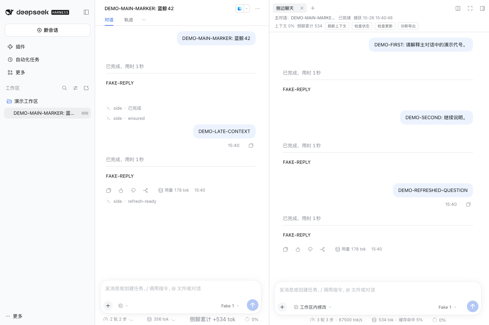

# DeepSeek Harness 侧边聊天

**简体中文** · [English](README.en.md)

[下载 macOS 安装包](https://github.com/HHH84h/deepseek-harness-side-chat/releases/download/v1.1.2/deepseek-harness-side-chat-macos-v1.1.2.zip) · [Releases](https://github.com/HHH84h/deepseek-harness-side-chat/releases)
**主任务继续，在旁边把问题问明白。**

通过 `/side` 在 DeepSeek Harness 右侧打开独立的只读对话。解释报错、讨论方案、阅读代码，不打断主任务，也不把侧聊问题写入主对话的模型上下文。

HHH84h 开发的社区插件，非 DeepSeek 官方产品。采用 MIT 许可。

## 界面预览



演示使用虚构内容和测试模型，用量与速度不代表真实模型性能。

## 主要功能

- **独立问答**：主聊继续执行，侧聊单独回答；取消侧聊不会取消主任务。
- **主聊快照**：首问捕获上下文，显示来源、时间和状态；主聊更新后可手动刷新，追问不重复捕获。
- **只读工具**：阅读文件、图片和搜索代码，不提供写入、编辑或终端执行工具。
- **独立统计**：显示侧聊用量和上下文占用，数据缺失时不编造数值。
- **临时会话**：收起保留、重启可恢复，明确结束后删除，不占普通会话列表。
- **失败恢复**：发送失败保留原文，删除失败提供清理重试；支持状态检查和脱敏诊断导出。

## 安装

**当前版本：1.1.2 · macOS · DeepSeek Harness 0.2.1-rc.3**

1. 从本项目 [Releases](https://github.com/HHH84h/deepseek-harness-side-chat/releases) 下载 `deepseek-harness-side-chat-macos-v1.1.2.zip`。
2. **解压整个文件夹**，保存工作并完全退出 Harness（`⌘Q`）。
3. 双击 **「安装或更新.command」**，等待提示成功。
4. 重新打开 Harness，在主对话输入 `/side`。

安装器自动检查应用版本、运行环境、profile、权限及安装冲突，先备份再安装，失败自动恢复。优先使用 Harness 自带运行环境，缺失时检查现有 Node 20+；不自动安装额外软件，也不强制退出应用。

**旧脚本版直接运行新版安装入口即可升级**，无需先卸载或迁移。重复安装同一份文件不会重复插入配置。

如果已安装原生 `.tgz` 版，请先在 Harness「插件」里停用并卸载侧聊，再退出应用运行脚本。两种方式不能并用，安装器遇到冲突会停止。

### 随附工具

| 双击入口 | 用途 |
| --- | --- |
| 安装或更新.command | 安装或升级，自动备份和失败恢复 |
| 检查安装.command | 核对文件、配置和链接，不修改安装 |
| 回退上一版.command | 恢复最近一次受管操作前的状态 |
| 卸载.command | 移除本插件安装，保留侧聊数据和备份 |

另附选用的「检查更新.command」。**此版更新源未启用**，检查不联网，也没有后台定时检查。

请保留解压文件夹。以后升级时，退出 Harness 后运行新版「安装或更新.command」；回退或卸载也需先退出应用。回退依赖本地备份，保留其他插件后续的独立配置改动；若本插件被手动修改，会停止覆盖。

成功后脚本自动结束；终端窗口是否关闭取决于你的 Terminal 设置。

## 使用

在主对话输入：

```text
/side
```

或打开侧栏并直接发送问题：

```text
/side 解释一下刚才报错的原因
```

侧聊首问使用主对话快照，后续追问沿用该快照。主聊新增内容后，点击 **「刷新上下文」**；生成中刷新会排队，失败则保留上次有效快照。快照可能截断，查看状态提示；具体工具报错可补充相关文本。

| 操作 | 会话内容 |
| --- | --- |
| 收起侧栏或切换主聊 | 保留，可继续 |
| 退出并重开 Harness | 未结束的侧聊可恢复 |
| 关闭侧聊标签并确认结束 | 删除对应本地会话与缓存；再次 `/side` 创建新会话 |
| 运行「卸载.command」 | 保留未结束的侧聊及恢复数据 |

删除失败时可在「待清理」处重试。侧聊使用你在 Harness 配置的模型服务；结束侧聊删除本地对应记录，不改变模型服务端的数据保留规则。

## 兼容与验证

本版仅适配 **macOS / Harness 0.2.1-rc.3**。其他 Harness 版本、Windows 和 Linux 未验证；客户端更新后可能需要新的适配包。

已通过 **111 项单元测试、17 项客户端测试、102 项宿主回归**，并验证实际解压包的安装、升级、失败恢复、回退、卸载，以及真实浏览器中的输入、快照刷新、统计、关闭与重启恢复。

测试使用隔离环境与记录型测试模型，不代表真实模型回答或用户桌面 Electron 全链路已验证。长期资源增长与顶部窗口偶发无法拖动的问题尚未完全归因；统计完整度取决于模型适配器。

详见[验收报告](docs/验收与隐私报告.md)和[安装与回退说明](docs/双击安装使用说明.md)。

## 反馈与许可

请在 [Issues](https://github.com/HHH84h/deepseek-harness-side-chat/issues) 提供插件、Harness、macOS 版本及复现步骤。可附检查过的脱敏诊断，不要附真实对话、密钥或整个配置目录。

[MIT](LICENSE) · HHH84h
